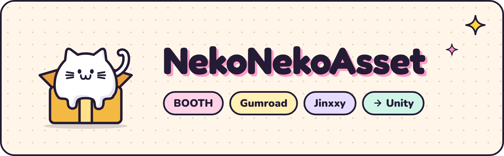

<p align="center">
  
</p>

<p align="center">
  <a href="https://github.com/Yan-K/NekoNekoAsset-Public/releases"></a>
  
  
  <a href="LICENSE"></a>
</p>

<p align="center">
  <a href="README.md">English</a> · <a href="README.zh-TW.md">繁體中文</a> · <b>日本語</b>
</p>

<h3 align="center">素材、買いすぎ？ ねこにおまかせ！</h3>

<p align="center">
NekoNekoAsset は Windows 向けのデスクトップアプリです。BOOTH・Gumroad・Jinxxy で買った VRChat 素材を同期して、ダウンロード・解凍・分類まで自動でこなし、Unity へもワンクリックで送ります。データはすべてあなたの PC の中だけ。
</p>

<p align="center">
  <a href="https://yan-k.github.io/NekoNekoAsset-Public/ja/"><b>公式サイト</b></a> · <a href="https://github.com/Yan-K/NekoNekoAsset-Public/releases"><b>Windows 版をダウンロード</b></a>
</p>

## 機能

- **購入履歴を自動で同期**。ログインは一度だけ。アプリを開くたびに、新しく買った素材がリストに並びます。
- **ダウンロード＋自動解凍**。ZIP・RAR・7z をフォルダー構成そのままで解凍。日本語のファイル名も文字化けせず、unitypackage は元のファイルを残します。
- **分類もタグも、すぐ見つかる**。自動分類に加えて、タグ・対応アバター・コレクションで整理。日本語でも中国語でも検索できます。
- **ワンクリックで Unity へ**。ファイルを選んで Unity のインポートプレビューを確認。確定するまで何も書き込みません。
- **手持ちのファイルも取り込み**。フォルダーや ZIP をドラッグするだけ。ライブラリにコピーを作るので、元のファイルはそのままです。
- **支出の集計・テーマ・言語**。支払いが確認できた金額を通貨ごとに集計。内蔵テーマが多数あり、English・繁體中文・简体中文・日本語・한국어に対応。

## 対応ストア

| 取り込み元 | 同期する内容 |
| --- | --- |
| BOOTH | ライブラリ、購入履歴、ギフト、無料アイテム |
| Gumroad | Library、Bundle |
| Jinxxy | Inventory |
| あなたの PC | フォルダー、ZIP、単体ファイル（ライブラリにコピーし、元のファイルはそのまま） |

どのストアも複数アカウントでログインでき、それぞれ独立して管理されます。

## インストール

1. [公式サイト](https://yan-k.github.io/NekoNekoAsset-Public/ja/)か [Releases](https://github.com/Yan-K/NekoNekoAsset-Public/releases) から、最新の `NekoNekoAsset_x.y.z_x64-setup.exe` をダウンロードします。
2. インストーラーを実行します。SmartScreen の警告が出たら、ファイルがこの 2 か所のどちらかから来たことを確かめて、「詳細情報」→「実行」を押してください。
3. ライブラリの保存先を選び、ストアにログイン（オフラインで始めることもできます）すれば完了です。

今のところ Windows 64 ビットのみ対応です。新しいバージョンはアプリ内でお知らせし、署名を検証してからインストールします。

## Unity Bridge

素材をワンクリックで Unity に送るには、Unity 2022.3 以降のプロジェクトに NekoNekoAsset Bridge を入れてください。3 つの形式は中身が同じなので、[Releases](https://github.com/Yan-K/NekoNekoAsset-Public/releases) からどれかひとつを選びます：

| 形式 | インストール方法 |
| --- | --- |
| `.unitypackage` | Unity の Project ウィンドウにドラッグしてインポート |
| UPM（`.tgz`） | Package Manager →「+」→「Add package from tarball…」 |
| VPM（`.zip`） | プロジェクトの `Packages/com.yank.nekonekoasset.bridge` に展開 |

Bridge が受け取るのは、あなたの PC の内部（localhost）にあるアプリからのファイルだけです。インポートのたびにまず Unity でプレビューを表示し、確認してから書き込みます。

## プライバシーとセキュリティ

あなたのデータは、あなたの PC の中だけ。NekoNekoAsset には独自のサーバーがなく、利用データも一切集めません。

- **パスワードに触れない**。ログインはストア公式のページで。アプリが保存するのはログイン cookie だけで、Windows DPAPI で暗号化されます。
- **クラウドなし**。データベース・サムネイル・素材は、あなたが選んだフォルダーの中に。アカウント登録もクラウド同期もありません。
- **トラッキングなし**。テレメトリー・利用分析・広告・クラッシュレポートは一切ありません。
- **AI は初期設定でオフ**。オンにしても、送るのはあなたが選んだテキストと画像だけで、送り先はあなたが選んだサービスです。
- **ソースコード公開**。MIT ライセンスなので、すべてのコードを確認できます。

アプリの接続先は、これで全部です：

| 接続先 | 目的 | タイミング |
| --- | --- | --- |
| BOOTH・Gumroad・Jinxxy | ログイン、リストの同期、購入ファイルのダウンロード | ログイン後 |
| Google・Apple・X などのログインサービス | それらのアカウントでストアにログイン | ログインのときだけ |
| GitHub | 公開のバージョン情報の確認とアップデートのダウンロード | アップデート確認時 |
| あなたが選んだ AI サービス | あなたが選んだテキストと画像 | AI をオンにして使うときだけ |
| あなたが貼り付けた商品 URL | 公開されている商品情報の取得 | ローカルファイルの取り込み時 |
| Unity Bridge | PC の内部（localhost）でのファイル転送 | インポート時 |

## よくある質問

### プライバシーとセキュリティ

<details>
<summary>NekoNekoAsset にストアのパスワードを知られますか？</summary>

**知られません**。ログインはアプリが開くストア公式のログインページで行うので、パスワードは BOOTH・Gumroad・Jinxxy に直接渡ります。NekoNekoAsset はパスワードを読み取ることも保存することもありません。保存するのはログイン後にストアが発行するログイン cookie だけで、あなた自身の購入リストの読み込みとファイルのダウンロードに使います。

</details>

<details>
<summary>ログイン情報はどこに保存されますか？盗まれる心配は？</summary>

アカウントごとのログイン情報は、この PC のユーザーフォルダーに別々に保存され、Windows 標準の **DPAPI で暗号化**されます。復号できるのは同じ PC の同じ Windows ユーザーだけなので、ファイルを別の PC にコピーしても使えません。ログイン情報がライブラリ・バックアップ・エクスポートに含まれることもありません。

注意：あなたの権限で動くマルウェアに PC がすでに感染している場合、どのローカルアプリでも完全には防げません。システムを安全に保ってください。

</details>

<details>
<summary>購入履歴やライブラリがクラウドにアップロードされることは？</summary>

**ありません**。データベース（SQLite）・サムネイル・ダウンロードしたファイルは、すべてあなたが選んだライブラリフォルダーに保存されます。NekoNekoAsset にはアカウントの仕組みも開発者のサーバーもなく、自動でアップロードしたりクラウドにバックアップしたりすることはありません。

OneDrive や Dropbox などの同期フォルダーにライブラリを置いた場合、アップロードするのはその同期ソフトで、アプリではありません。ローカルのドライブか NAS に置くことをおすすめします。

</details>

<details>
<summary>開発者に私のデータは見えますか？利用データを集めていませんか？</summary>

**見えませんし、集めてもいません**。アプリにはテレメトリー・利用分析・広告・クラッシュレポートのツールが一切ありません。開発者に関係する通信はひとつだけで、起動時に GitHub から公開のバージョン情報ファイルを読み込み、アップデートを確認するものです。このリクエストにアカウント・購入履歴・素材のデータは含まれません。

</details>

<details>
<summary>アプリはどこに接続するのですか？</summary>

上の「プライバシーとセキュリティ」にある接続先の表がすべてです。Unity Bridge は PC の内部だけでファイルを転送し、外部のネットワークには接続しません。

</details>

<details>
<summary>AI 機能はデータをどこに送りますか？</summary>

**AI は初期設定でオフです**。オンにするには、ご自身の API キーを入力します。アプリが送るのは、選んだ商品のテキスト情報（名前・タグ・ファイル名・説明書の抜粋など）と、明示的に選んだ画像だけで、送り先は「あなたが選んだひとつの」AI サービスです。PC 上で動くローカルモデルを使うこともできます。

サムネイルの解析も初期設定でオフで、画像は事前に 1536px 以内に縮小されます。ログイン cookie・ダウンロードリンク・素材のアーカイブが送られることはありません。

</details>

<details>
<summary>AI の API キーはどこに保存されますか？</summary>

**Windows 資格情報マネージャー**に、キーごとに別々に保存されます。この PC の中だけに残り、ライブラリ・バックアップ・エクスポート・ログに含まれることはありません。

</details>

<details>
<summary>バックアップやエクスポート、「診断情報をコピー」に個人情報は含まれますか？</summary>

バックアップとエクスポートには**ログイン情報も API キーも含まれません**。「診断情報をコピー」でコピーされるのは、決まった形式の状態とカウント（どのステップで止まったか、何回リトライしたかなど）だけで、アカウント・注文・商品名・URL・ファイルパスは含みません。コピー先はクリップボードだけで、誰かに渡すかどうかはあなたが決めます。

</details>

<details>
<summary>ライブラリを NAS に置いたり、2 台の PC で交互に使ったりしても安全？</summary>

大丈夫です。ひとつのライブラリは**同時に 1 台の PC でしか開けません**。同時書き込みによる破損を防ぐため、アプリが自動でロックします。アプリを閉じれば、もう 1 台で続きを使えます。

ログイン情報・API キー・AI チャットの履歴はそれぞれの PC にだけ保存されるので、PC を替えたときはストアに再ログインしてください。

</details>

<details>
<summary>ログイン情報を消すには？</summary>

アカウント設定で「ログアウト」か「削除」を押すと、この PC にあるそのアカウントのログイン状態と暗号化された cookie が消去されます。アカウントを削除するときは、アセット情報も一緒に削除するかを選べます。ダウンロード済みのファイルは残ります。AI キーは AI 設定から削除できます。

</details>

<details>
<summary>Unity Bridge がプロジェクトを勝手に変更することは？</summary>

Bridge は PC の内部だけでアプリからファイルを受け取り、接続には認証が必要で、外部のネットワークには接続しません。インポートのたびに**まず Unity でプレビューを表示し、あなたが確認してから書き込みます**。インポートに失敗したときも、消すのはそのインポートで新しく書き込まれ、その後変更されていないファイルだけです。

</details>

<details>
<summary>公式ツールですか？使うとリスクはありますか？</summary>

**公式ツールではありません**。NekoNekoAsset は個人が開発した非公式のオープンソースプロジェクトで、BOOTH（pixiv）・Gumroad・Jinxxy・VRChat・Unity とは関係ありません。アプリはあなた自身のログイン状態であなた自身の購入リストを読み込み、リクエストの速度を抑え、サーバーが求める待ち時間を守ります。各プラットフォームの利用規約は公式の情報を確認し、ご自身で判断してください。

</details>

<details>
<summary>インストール時に「Windows によって PC が保護されました」と出るのはなぜ？</summary>

インストーラーにはまだ有料のコード署名証明書がないため、SmartScreen が警告することがあります。**公式サイトかこのプロジェクトの GitHub Releases からだけダウンロード**し、提供元を確かめたうえで「詳細情報」→「実行」を押してください。アプリ内の自動アップデートは、署名を検証してからインストールします。

</details>

### 使いかた

<details>
<summary>有料ですか？</summary>

完全無料で、MIT ライセンスのオープンソースです。

</details>

<details>
<summary>対応している OS は？</summary>

今のところ Windows（64 ビット）のみです。macOS と Linux にはまだ対応していません。

</details>

<details>
<summary>ログインすると、素材がすべてダウンロードされますか？</summary>

されません。自動ダウンロードは初期設定でオフで、同期ではまず商品情報とサムネイルだけを取得します。何をダウンロードするかはあなたが決められ、あとから設定で自動ダウンロードをオンにすることもできます。

</details>

<details>
<summary>Unity のインストールは必須ですか？</summary>

必須ではありません。「ワンクリックで Unity へ」を使いたいときだけ、Unity 2022.3 以降のプロジェクトに NekoNekoAsset Bridge を入れてください（unitypackage・UPM・VPM の 3 形式を用意しています）。

</details>

<details>
<summary>「すべて」に表示されない商品があるのはなぜ？</summary>

BOOTH では VRChat と関係のない商品もたくさん売られているため、初期設定の「すべて」には VRChat 関連の素材だけを表示します。それ以外の商品もきちんと保存されていて、「未分類」で見つけたり、手動でカテゴリを変えたりできます。

</details>

ほかにも質問があれば、[GitHub Issues で質問](https://github.com/Yan-K/NekoNekoAsset-Public/issues)してください。

## ソースからビルド

```sh
cd app
pnpm install --frozen-lockfile
pnpm native:dev      # 開発モード
pnpm native:build    # インストーラーをビルド
```

Node.js と pnpm、Rust（MSVC ツールチェーン）、Visual Studio の C++ ビルドツールと Windows SDK、WebView2 Runtime が必要です。開発に参加する前に [CONTRIBUTING.md](CONTRIBUTING.md) をお読みください。

## ライセンス

ソースコードは [MIT ライセンス](LICENSE)で公開しています。同梱のサードパーティ製コンポーネント（7-Zip、Noto Sans CJK など）はそれぞれのライセンスに従います。詳しくは [app/src-tauri/resources/licenses](app/src-tauri/resources/licenses) をご覧ください。公式サイトのフォント（Fredoka、Nunito、Chiron GoRound TC、Zen Maru Gothic）は SIL Open Font License です。詳しくは [site/assets/fonts](site/assets/fonts) をご覧ください。

## 免責事項

NekoNekoAsset は個人による非公式のオープンソースプロジェクトで、BOOTH（pixiv）・Gumroad・Jinxxy・VRChat・Unity とは一切関係ありません。記載の商標はそれぞれの所有者に帰属します。
