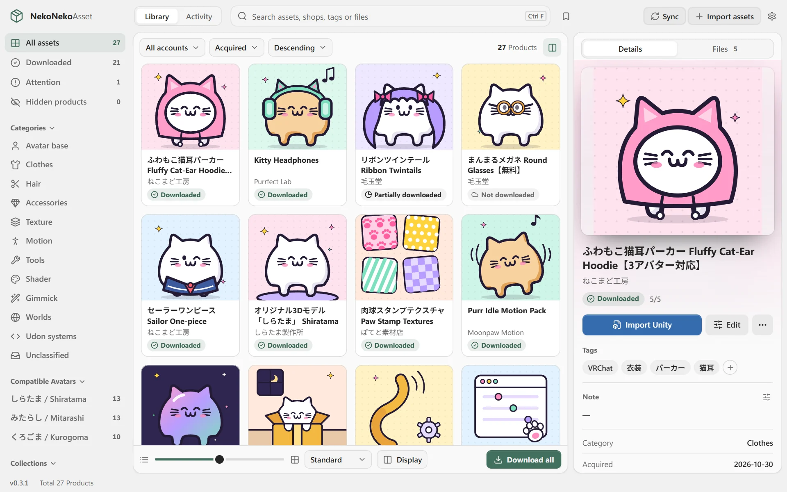
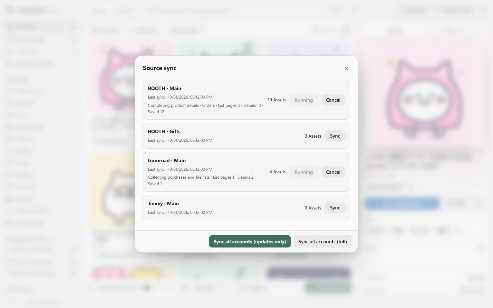
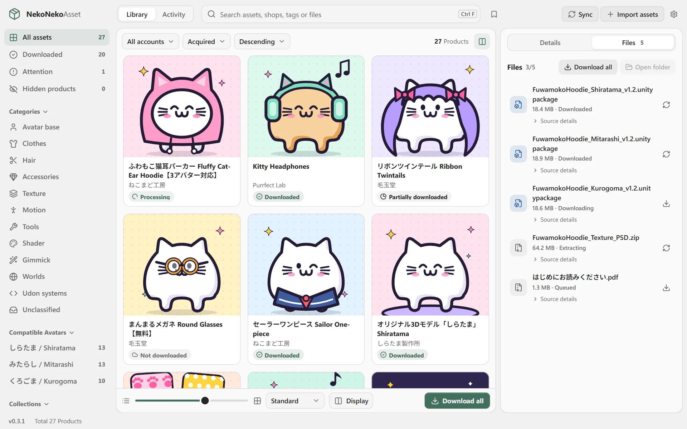
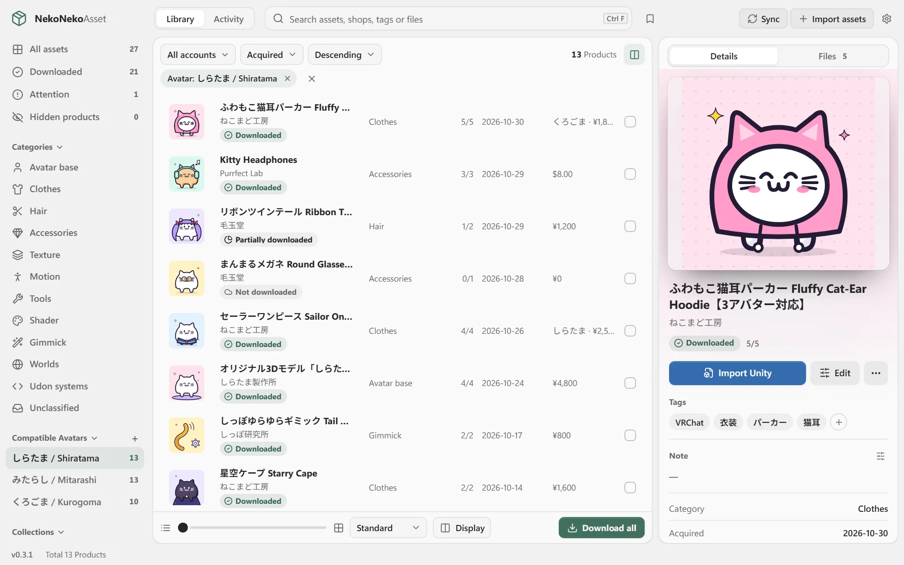
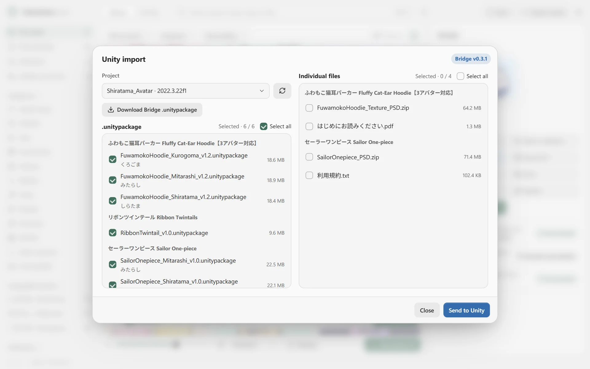
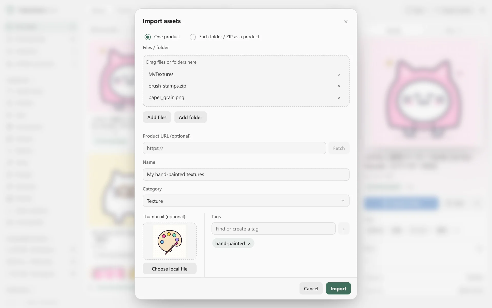
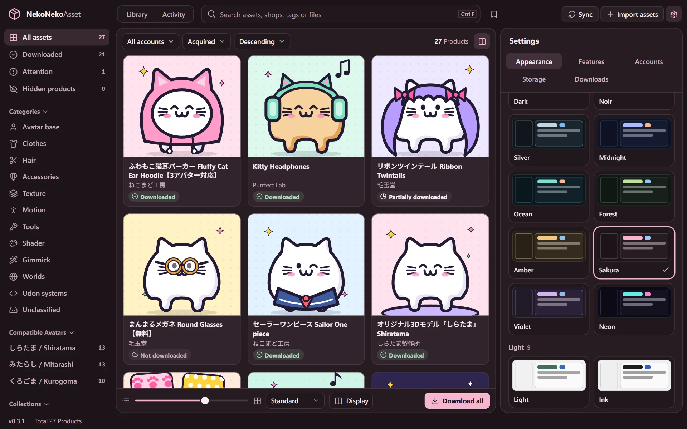

<p align="center">
  
</p>

<p align="center">
  <a href="https://github.com/Yan-K/NekoNekoAsset-Public/releases"></a>
  
  
  <a href="LICENSE"></a>
</p>

<p align="center">
  <b>English</b> · <a href="README.zh-TW.md">繁體中文</a> · <a href="README.ja.md">日本語</a>
</p>

<h3 align="center">Too many assets? Let the cat sort them!</h3>

<p align="center">
NekoNekoAsset is a Windows desktop app that syncs the VRChat assets you bought on BOOTH, Gumroad and Jinxxy, downloads, extracts and sorts them, then sends them to Unity in one click. All of your data stays on your computer.
</p>

<p align="center">
  <a href="https://yan-k.github.io/NekoNekoAsset-Public/"><b>Website</b></a> · <a href="https://github.com/Yan-K/NekoNekoAsset-Public/releases"><b>Download for Windows</b></a>
</p>

<p align="center">
  
</p>

## Features

- **Purchases sync on their own.** Sign in once, and new purchases appear in your list every time you open the app.
- **Download + auto extract.** ZIP, RAR and 7z are extracted with their folders intact, Japanese filenames stay readable, and original unitypackage files are kept.
- **Sorted, tagged, easy to find.** Automatic categories, tags, avatar compatibility and collections. Search works with Japanese titles too.
- **One-click Unity import.** Pick files, check Unity’s import preview, and nothing is written until you confirm.
- **Bring your own files.** Drag in folders and ZIPs. The app copies them into your library and never touches the originals.
- **Spending, themes and languages.** Per-currency totals from proven payments, built-in themes, and English, 繁體中文, 简体中文, 日本語 and 한국어.

<table>
  <tr>
    <td width="50%" valign="top"><br><sub><b>Purchases sync on their own</b></sub></td>
    <td width="50%" valign="top"><br><sub><b>Download + auto extract</b></sub></td>
  </tr>
  <tr>
    <td width="50%" valign="top"><br><sub><b>Sorted, tagged, easy to find</b></sub></td>
    <td width="50%" valign="top"><br><sub><b>One-click Unity import</b></sub></td>
  </tr>
  <tr>
    <td width="50%" valign="top"><br><sub><b>Bring your own files</b></sub></td>
    <td width="50%" valign="top"><br><sub><b>Built-in themes</b></sub></td>
  </tr>
</table>

<sub>Screenshots show the real app, filled with made-up demo data.</sub>

## Supported stores

| Source | What syncs |
| --- | --- |
| BOOTH | Library, purchases, gifts, free items |
| Gumroad | Library, bundles |
| Jinxxy | Inventory |
| Your computer | Folders, ZIPs and single files, copied into your library with the originals untouched |

Every store supports several accounts, each kept separate.

## Install

1. Download the latest `NekoNekoAsset_x.y.z_x64-setup.exe` from the [website](https://yan-k.github.io/NekoNekoAsset-Public/) or [Releases](https://github.com/Yan-K/NekoNekoAsset-Public/releases).
2. Run the installer. If SmartScreen warns you, make sure the file came from one of those two places, then click **More info** → **Run anyway**.
3. Choose where your library lives, sign in to your stores (or start offline), and you are done.

Windows 64-bit only for now. New versions are offered inside the app and installed only after their signature checks out.

## Unity Bridge

To send assets to Unity in one click, install the NekoNekoAsset Bridge in a Unity 2022.3 or later project. All three formats contain the same package, so pick one from [Releases](https://github.com/Yan-K/NekoNekoAsset-Public/releases):

| Format | How to install |
| --- | --- |
| `.unitypackage` | Drag it into Unity’s Project window |
| UPM (`.tgz`) | Package Manager → **+** → **Add package from tarball…** |
| VPM (`.zip`) | Extract it to `Packages/com.yank.nekonekoasset.bridge` in your project |

The Bridge only receives files from the app on your own computer (localhost). Every import shows Unity’s preview first and writes nothing until you confirm.

## Privacy and security

Your data lives only on your computer. NekoNekoAsset has no servers of its own and collects no usage data.

- **Never sees your password.** You sign in on each store’s official page. The app keeps only the login cookie, encrypted with Windows DPAPI.
- **No cloud.** The database, thumbnails and assets stay in the folder you choose. No sign-up, no cloud sync.
- **Zero tracking.** No telemetry, analytics, ads or crash reporting.
- **AI is off by default.** When you turn it on, only the text and images you select go to the service you choose.
- **Open source.** MIT licensed, so every line is here for you to check.

Every place the app connects to:

| Connects to | What for | When |
| --- | --- | --- |
| BOOTH, Gumroad, Jinxxy | Sign-in, syncing your lists, downloading files you bought | After you sign in |
| Google, Apple, X and other sign-in services | Signing in to a store with those accounts | Only while signing in |
| GitHub | Reading public version info and downloading updates | When checking for updates |
| The AI service you choose | The text and images you select | Only when AI is on and you use it |
| Product URLs you paste | Fetching public product details | When importing local files |
| Unity Bridge | Moving files inside your computer (localhost) | When you import |

## FAQ

### Privacy and security

<details>
<summary>Does NekoNekoAsset know my store passwords?</summary>

**No.** You sign in on the store’s official login page that the app opens, so your password goes straight to BOOTH, Gumroad or Jinxxy. NekoNekoAsset never reads or stores it. It keeps only the login cookie the store issues after you sign in, and uses it to read your own purchase lists and download your own files.

</details>

<details>
<summary>Where is my sign-in data stored? Could someone take it?</summary>

Each account’s sign-in data is stored separately in your user folder on this computer and encrypted with Windows’ built-in **DPAPI**. Only the same Windows user on the same computer can decrypt it, so a copy on another computer is useless. Sign-in data never goes into your library, backups or exports.

A note of caution: if your computer already runs malware under your account, no local app can fully protect against it, so keep your system secure.

</details>

<details>
<summary>Are my purchase history and library uploaded to the cloud?</summary>

**No.** The database (SQLite), thumbnails and downloaded files all stay in the library folder you choose. NekoNekoAsset has no account system and no developer server, and it never uploads or backs up anything to the cloud.

If you put your library inside a cloud-synced folder such as OneDrive or Dropbox, it is that sync software that uploads it, not the app. We recommend a local drive or a NAS.

</details>

<details>
<summary>Can the developer see my data? Is usage data collected?</summary>

**No, and no.** The app has no telemetry, analytics, ads or crash reporters. The only developer-related connection is reading a public version file from GitHub at startup to check for updates, and that request contains none of your accounts, purchases or assets.

</details>

<details>
<summary>Exactly where does the app connect?</summary>

Everything is in the connection table above. Unity Bridge moves files only inside your computer and never connects to the internet.

</details>

<details>
<summary>Where does the AI feature send my data?</summary>

**AI is off by default.** To turn it on you enter your own API key. The app then sends only text from the items you select (such as names, tags, filenames and excerpts from included documents) and the images you explicitly choose, to the one AI service you picked. You can also use a local model running on your own computer.

Thumbnail analysis is off by default too, and images are scaled down to 1536px or less first. Login cookies, download links and asset archives are never sent.

</details>

<details>
<summary>Where are AI API keys stored?</summary>

In **Windows Credential Manager**, each key separately. They stay on this computer and never go into your library, backups, exports or logs.

</details>

<details>
<summary>Do backups, exports or “Copy diagnostics” include private data?</summary>

Backups and exports **never include sign-in data or API keys**. “Copy diagnostics” copies only fixed-format status and counts (such as which step a job stopped at and how many retries happened), without accounts, orders, product names, URLs or file paths. It only goes to your clipboard, and you decide whether to share it.

</details>

<details>
<summary>Is it safe to keep my library on a NAS or use it from two computers?</summary>

Yes. A library can be **open on only one computer at a time**. The app locks it automatically so simultaneous writes cannot damage it; close the app and the other computer can take over.

Sign-in data, API keys and AI chat history stay on each computer, so you sign in to your stores again when you switch computers.

</details>

<details>
<summary>How do I remove my sign-in data?</summary>

In account settings, click “Sign out” or “Delete” to clear that account’s session and encrypted cookies on this computer. When deleting an account you can choose to delete its asset records too; downloaded files are kept. AI keys can be removed in AI settings.

</details>

<details>
<summary>Could Unity Bridge mess up my project?</summary>

The Bridge only receives files from the app inside your computer, over an authenticated connection, and never connects to the internet. Every import **shows a preview in Unity first and writes only after you confirm**. If an import fails, it cleans up only the files that import newly wrote and that have not been changed since.

</details>

<details>
<summary>Is this an official tool? Is it risky to use?</summary>

**It is not official.** NekoNekoAsset is an unofficial open-source project made by an individual and is not affiliated with BOOTH (pixiv), Gumroad, Jinxxy, VRChat or Unity. The app reads your own purchase lists with your own sign-in, limits its request rate and waits as long as servers ask. Please check each platform’s terms yourself and make your own call.

</details>

<details>
<summary>Why does the installer show “Windows protected your PC”?</summary>

The installer is not signed with a paid code-signing certificate yet, so SmartScreen may warn you. **Only download it from the official website or this project’s GitHub Releases**. Once you have checked the source, click “More info” → “Run anyway”. In-app updates verify their signature before installing.

</details>

### Using the app

<details>
<summary>Does it cost anything?</summary>

It is completely free and open source under the MIT license.

</details>

<details>
<summary>Which operating systems are supported?</summary>

Only Windows (64-bit) for now. macOS and Linux are not supported yet.

</details>

<details>
<summary>Will it download all my assets as soon as I sign in?</summary>

No. Auto download is off by default, and sync fetches only product details and thumbnails first. You decide what to download, and you can turn on auto download in settings later.

</details>

<details>
<summary>Do I need Unity installed?</summary>

No. You only need the NekoNekoAsset Bridge, installed in a Unity 2022.3 or later project, if you want one-click import into Unity. It comes as a unitypackage, a UPM package and a VPM package.

</details>

<details>
<summary>Why are some items missing from “All”?</summary>

BOOTH also sells plenty of things unrelated to VRChat, so the default “All” view shows only VRChat-related assets. Everything else is still saved: you can find it under “Unclassified” or change an item’s category yourself.

</details>

Still have questions? [Ask on GitHub Issues](https://github.com/Yan-K/NekoNekoAsset-Public/issues).

## Build from source

```sh
cd app
pnpm install --frozen-lockfile
pnpm native:dev      # development
pnpm native:build    # build the installer
```

Requires Node.js and pnpm, Rust (MSVC toolchain), the Visual Studio C++ build tools with the Windows SDK, and the WebView2 Runtime. Please read [CONTRIBUTING.md](CONTRIBUTING.md) before contributing.

## License

The source code is released under the [MIT License](LICENSE). Bundled third-party components such as 7-Zip and Noto Sans CJK keep their own licenses; see [app/src-tauri/resources/licenses](app/src-tauri/resources/licenses). The website fonts (Fredoka, Nunito, Chiron GoRound TC and Zen Maru Gothic) are under the SIL Open Font License; see [site/assets/fonts](site/assets/fonts).

## Disclaimer

NekoNekoAsset is an unofficial personal open-source project and is not affiliated with BOOTH (pixiv), Gumroad, Jinxxy, VRChat or Unity. All trademarks belong to their respective owners.
